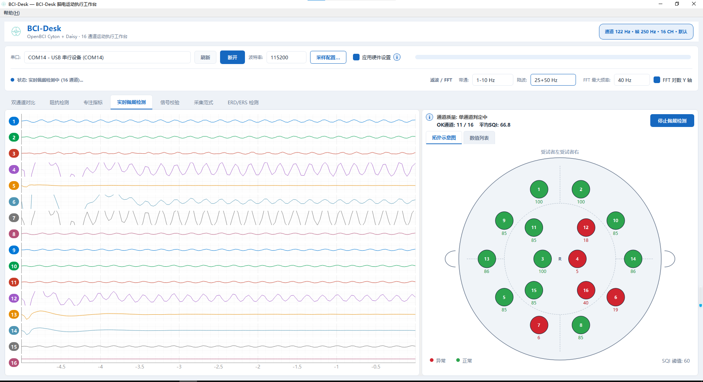
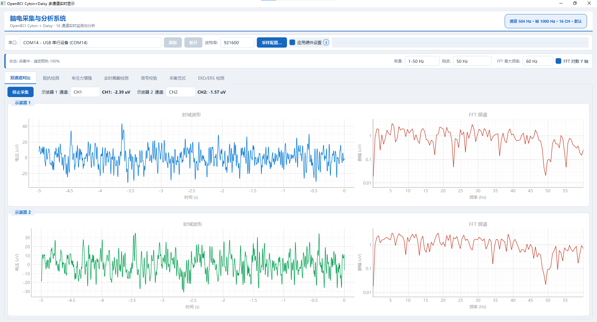

# BCI-Desk

**Open-source EEG BCI workbench** for OpenBCI Cyton + Daisy (16-ch) — hand **ME** / **MI**, finger paradigms, ERD/ERS.

`#bci` `#eeg` `#openbci` `#brainflow` `#motor-execution` `#motor-imagery` `#hand-me` `#hand-mi` `#erd-ers` `#eegnet` `#bci-desk` `#python` `#pyqt`

**开发目的**：面向 OpenBCI 系列硬件，搭建可用的本地 BCI 基础平台，把连接、质检、采集、基础分析到落盘训练的基本流程跑通，方便在此之上做更深度的个性化与科研 / 教育扩展。

BCI-Desk 当前面向 **OpenBCI Cyton + Daisy（16 通道）**：实时波形与阻抗、专注力 / 佩戴检测、信号校验、多范式运动执行（ME）采集，以及 ERD/ERS 时频分析。可复用逻辑在 `bci_desk/`（无 torch）；服务器侧 EEGNet 训练在 `training/`（自包含，不依赖本包）。

> **研究 / 教育用途 · 非医疗器械** — 详见 [NOTICE.md](NOTICE.md) 与 [LICENSE](LICENSE)。  
> 当前版本：**0.1.0**（见 `bci_desk/__about__.py`）

<p align="center">
  
</p>
<p align="center"><em>实时佩戴检测 — 16 通道波形 + 头皮拓扑 SQI</em></p>

<p align="center">
  
</p>
<p align="center"><em>双通道对比 — 时域波形与 FFT（921600 高速档）</em></p>

## Topics（GitHub 仓库 Settings → Topics）

```
bci, eeg, openbci, brainflow, motor-execution, motor-imagery, hand-me, hand-mi, erd-ers, eegnet, bci-desk, python, pyqt
```

## 功能概览

| 模块 | 说明 |
|------|------|
| 双通道对比 | 实时 EEG 波形与频谱 |
| 阻抗检测 | 16 通道接触质量 |
| 专注指标 | β/(α×4) 专注指数与对比指标 |
| 实时佩戴检测 | 通道 SQI |
| 信号校验 | 固定时长录制与回放 |
| 采集范式 | 手指 / 手形 ME，打标签落盘（训练集 / 测试集） |
| ERD/ERS | 握拳等范式时频分析 |

## 环境要求

- **Python** 3.10+（建议）
- **硬件**：OpenBCI Cyton + Daisy（16-ch EEG）
- **OS**：Windows / macOS / Linux（开发与实测以 Windows 为主）

GUI 依赖：

```bash
pip install -r requirements.txt
```

训练端另见 [`training/requirements.txt`](training/requirements.txt)（含 PyTorch 等）。

## 快速开始

```bash
# 建议独立 conda / venv
pip install -r requirements.txt
python main.py
```

操作说明：[docs/USER_GUIDE.md](docs/USER_GUIDE.md)（程序内：**帮助 → 操作手册**）。

### 推荐操作流程

1. 工具栏选择串口与波特率 → **连接**
2. **阻抗检测** → 多数通道 ≤ 100 kΩ
3. （可选）佩戴检测 / 信号校验
4. **采集范式** → 选择范式 → 训练采集或测试集采集

### 调试虚拟端口

默认隐藏（仅动画预览、**不落盘**）。需要时：

```bash
# Windows PowerShell
$env:BCI_DESK_DEBUG="1"; python main.py
# 或
python main.py --debug
```

## 硬件与采样率

| 档位 | 波特率 | 帧率 | 通道率 | 驱动 |
|------|--------|------|--------|------|
| 默认 | 115200 | 250 Hz | **125 Hz** | BrainFlow |
| 高速 | 921600 | 1000 Hz | **500 Hz** | pyserial 直连 |

返回值已缩放为微伏（µV）。外部须按 OpenBCI 手册配置 SW4 / 适配器波特率与 `~` 采样率命令，再在本软件连接。细则见 [`bci_desk/acquisition/HARDWARE_SETUP_NOTES.md`](bci_desk/acquisition/HARDWARE_SETUP_NOTES.md)。

## 采集范式

GUI「采集范式」页支持下列 ME 范式（不同范式请分别采集、分别训练）：

| 范式 id | 名称 | 类别 |
|---------|------|------|
| `finger_2` | 两指运动执行 | THUMB / PINKY |
| `finger_3` | 三指运动执行 | THUMB / INDEX / PINKY |
| `finger_4` | 四指运动执行 | THUMB / INDEX / MIDDLE / PINKY |
| `hand_2class` | 手形二分类 | FIST / RELAX（握拳 4s / 放松 3s） |
| `hand_3class` | 手形三分类 | FIST / RELAX / PALM |

- **训练采集** → `data/acquisition/<paradigm_id>/…`
- **测试集采集** → `data/test/<paradigm_id>/…`（供服务器 `training/evaluate.py`，**非**本机实时分类）
- 段间提示出现时按 **空格** 继续；可用「受试者全屏提示」另开提示窗

落盘为带标签 CSV + 旁车 `.meta.json`（`timestamp, event_type, EEG Channel 1..16`）。格式约定见 [`training/README.md`](training/README.md)。

## 训练与评估（服务器）

`training/` 可整体拷贝到服务器运行，**不依赖**本地 `bci_desk` 包。模型为 PyTorch EEGNet，预处理与参考工程对齐。

```bash
cd training
pip install -r requirements.txt

# 训练（示例：手形二分类）
python train.py --data path/to/data/acquisition/hand_2class/HAND2_xxx \
  --paradigm hand_2class --out models/eegnet_hand2.pth --epochs 300

# 离线评估
python evaluate.py --model models/eegnet_hand2.pth \
  --data path/to/data/test/hand_2class/HAND2_test_xxx/
```

完整参数、数据契约与预处理流水线见 [`training/README.md`](training/README.md)。

## 仓库结构

```
main.py                 # GUI 入口
bci_desk/               # 本地可复用模块（无 torch）
  acquisition/          # 板卡、录制、校验、硬件设置
  data/                 # epoch / 对齐
  paradigms.py          # 范式注册表
  erders.py             # ERD/ERS
assets/                 # 图标与范式提示图
docs/                   # 用户操作手册（含 docs/images/ 操作截图）
training/               # 服务器训练（自包含 EEGNet）
data/                   # 运行时数据（默认不提交）
  acquisition/          # 训练采集
  test/                 # 测试集采集
  validation/           # 信号校验
  logs/                 # 应用日志
requirements.txt        # GUI 依赖
LICENSE                 # MIT
NOTICE.md               # 免责与非医疗声明
```

## 开源权益与贡献

- **许可**：MIT（见 [LICENSE](LICENSE)）。可自由使用、修改、再分发（含闭源商用），须保留版权与许可声明。
- **贡献**：欢迎 Issue / PR。提交代码即表示同意以 MIT 许可纳入本项目。
- **商标**：OpenBCI、BrainFlow 等为第三方商标，与本项目无隶属关系。
- **免责**：本软件不提供任何明示或默示担保，详见 [NOTICE.md](NOTICE.md)。

## 致谢

- [OpenBCI](https://openbci.com/) 硬件与协议
- [BrainFlow](https://brainflow.org/) 板卡驱动
- 社区与历史参考实现（已重写进 `bci_desk/`，运行时不依赖旧脚本）
